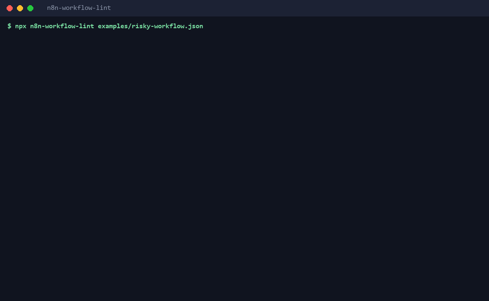

# n8n Workflow Lint: production-readiness linter and GitHub Action for n8n workflows

[](LICENSE)


**Big n8n template dumps say "test before use". This tests them.** One zero-dependency CLI and GitHub Action that reads n8n workflow JSON and tells you, before production does: leaked secrets, missing error handling, unbounded AI-agent loops, and what the LLM bill could look like.



_The GIF is rendered from the real CLI output of the two example workflows in [`examples/`](examples/)._

## 60-second quickstart

```bash
# Run straight from GitHub, nothing to install (Node 20+):
npx github:waseemnasir2k26/n8n-workflow-lint ./my-workflows

# or clone it:
git clone https://github.com/waseemnasir2k26/n8n-workflow-lint && cd n8n-workflow-lint
node bin/cli.js examples/risky-workflow.json
```

Export a workflow from n8n (Download), point the linter at the file, a folder, or a glob (`"workflows/**/*.json"`). Add it to CI with the Action:

```yaml
# .github/workflows/n8n-lint.yml
name: n8n lint
on: [push, pull_request]
permissions:
  contents: read
  security-events: write # for the SARIF upload
jobs:
  lint:
    runs-on: ubuntu-latest
    steps:
      - uses: actions/checkout@v4
      - uses: waseemnasir2k26/n8n-workflow-lint@v1
        with:
          path: workflows
          fail-on: high
          min-score: 80
```

Findings show up in the Security tab (code scanning) and as a markdown summary on the run.

## What it checks

19 rules in three groups. Every rule has an id, a severity, a message, a fix hint and a page in [`docs/rules/`](docs/rules/README.md).

| Rule                             | Severity | Group       | Catches                                                    |
| -------------------------------- | -------- | ----------- | ---------------------------------------------------------- |
| [`N8N001`](docs/rules/N8N001.md) | critical | Security    | Hardcoded secret in Code or HTTP node                      |
| [`N8N002`](docs/rules/N8N002.md) | high     | Security    | pinData leaked in the export                               |
| [`N8N003`](docs/rules/N8N003.md) | high     | Security    | Webhook with no authentication                             |
| [`N8N004`](docs/rules/N8N004.md) | info     | Security    | Credential referenced by instance id/name, not placeholder |
| [`N8N005`](docs/rules/N8N005.md) | medium   | Security    | TLS certificate validation disabled                        |
| [`N8N010`](docs/rules/N8N010.md) | high     | Reliability | No error workflow                                          |
| [`N8N011`](docs/rules/N8N011.md) | medium   | Reliability | HTTP Request without retry or timeout                      |
| [`N8N012`](docs/rules/N8N012.md) | medium   | Reliability | Loop with no exit branch                                   |
| [`N8N013`](docs/rules/N8N013.md) | low      | Reliability | Orphan or disconnected node                                |
| [`N8N014`](docs/rules/N8N014.md) | low      | Reliability | Default node names                                         |
| [`N8N015`](docs/rules/N8N015.md) | low      | Reliability | Deprecated node typeVersion                                |
| [`N8N016`](docs/rules/N8N016.md) | medium   | Reliability | $input.first() without a guard                             |
| [`N8N017`](docs/rules/N8N017.md) | medium   | Reliability | No trigger node                                            |
| [`N8N018`](docs/rules/N8N018.md) | info     | Reliability | Disabled nodes left in workflow                            |
| [`N8N019`](docs/rules/N8N019.md) | medium   | Reliability | Execute Command node                                       |
| [`N8N020`](docs/rules/N8N020.md) | high     | AI cost     | AI Agent without a sane iteration cap                      |
| [`N8N021`](docs/rules/N8N021.md) | high     | AI cost     | Retry path loops back into an LLM node                     |
| [`N8N022`](docs/rules/N8N022.md) | high     | AI cost     | HTTP error output wired back into an agent                 |
| [`N8N023`](docs/rules/N8N023.md) | low      | AI cost     | High estimated monthly LLM token cost                      |

Scorecard: start at 100, subtract per finding (critical 25, high 12, medium 5, low 2, info 0), floor 0. Grades: A 90+, B 80+, C 70+, D 60+, F below. A directory's score is the mean of its workflows.

## Features

| Feature                   | Detail                                                                                                                       |
| ------------------------- | ---------------------------------------------------------------------------------------------------------------------------- |
| Zero runtime dependencies | Node 20+, ESM, offline, deterministic output                                                                                 |
| Output formats            | `text`, `json`, `sarif` (SARIF 2.1.0), `md`, `html` (self-contained)                                                         |
| CI friendly               | Exit `0` clean, `1` findings at or above `--fail-on` (default `high`) or score below `--min-score`, `2` parse or usage error |
| Rule control              | `--rules`, `--disable`, `.n8nlintrc.json`, per-node `n8n-lint-disable N8N011` in the node Notes                              |
| AI cost estimate          | Upper-bound monthly token cost per workflow from a bundled, dated price table (`--runs-per-day`, `--cost-threshold`)         |
| Badge                     | `--badge` prints a shields.io markdown badge for your score                                                                  |
| GitHub Action             | Composite action, uploads SARIF to code scanning                                                                             |

### CLI

```
n8n-workflow-lint <file|dir|glob>... [options]

  --format <text|json|sarif|md|html>  output format (default: text)
  --out <file>                        write the report to a file
  --fail-on <severity>                info|low|medium|high|critical (default: high)
  --min-score <N>                     also fail if the overall score is below N
  --rules <r1,r2>   --disable <r3>    select or skip rules
  --config <file>                     default: .n8nlintrc.json if present
  --runs-per-day <N>                  for the cost estimate (default: 100)
  --cost-threshold <USD>              monthly USD at which N8N023 fires (default: 100)
  --badge                             print a shields.io badge for the overall score
  --list-rules                        list all rules
```

`.n8nlintrc.json` example:

```json
{
  "disable": ["N8N018"],
  "failOn": "medium",
  "minScore": 85,
  "severity": { "N8N014": "info" }
}
```

## Real demo output

Output below is pasted from running `node bin/cli.js examples/risky-workflow.json` and `node bin/cli.js examples/fixed-workflow.json` (the Bearer value in the risky example is a made-up demo string).

**Before** (`examples/risky-workflow.json`):

```text
examples/risky-workflow.json  (Lead intake agent (risky))  score 0/100 [F]
  [CRITICAL] N8N001  "HTTP Request": Bearer token at headerParameters.parameters[0].value (Bear...(38 chars)).
             fix: Move the value into an n8n credential or an environment variable and reference it by expression; rotate the exposed secret.
  [HIGH]     N8N002  pinData present on 1 node(s) (1 item(s)): Webhook.
             fix: Unpin data in the editor (or delete the "pinData" key) before sharing or committing the workflow.
  [HIGH]     N8N003  "Webhook": Webhook node accepts unauthenticated requests.
             fix: Set Authentication to Header Auth / Basic Auth / JWT on the Webhook node, or verify a signature in the first node.
  [HIGH]     N8N010  No Error Workflow is configured and there is no Error Trigger.
             fix: Set Settings -> Error Workflow to a workflow that starts with an Error Trigger and alerts you (Slack, email).
  [HIGH]     N8N021  "AI Agent": Cycle through "AI Agent" -> "Code" -> "HTTP Request1" re-enters an LLM node with no ceiling.
             fix: Break the cycle: cap attempts with a counter and an IF, or use node-level Retry On Fail (bounded by maxTries) instead of wiring a loop.
  [HIGH]     N8N022  "HTTP Request1": Error output of "HTTP Request1" reaches AI Agent "AI Agent".
             fix: Send the error output to an alert/stop path (Stop and Error, Slack), not back into the agent. Cap agent iterations (N8N020).
  [MEDIUM]   N8N005  "HTTP Request": HTTP Request ignores invalid TLS certificates.
             fix: Turn off "Ignore SSL Issues" and install the correct CA certificate or fix the endpoint certificate.
  [MEDIUM]   N8N011  "HTTP Request": HTTP Request is missing retryOnFail and timeout.
             fix: Enable "Retry On Fail" (3 tries, 2-5 s wait) and set Options -> Timeout (e.g. 30000 ms).
  [MEDIUM]   N8N011  "HTTP Request1": HTTP Request is missing retryOnFail and timeout.
             fix: Enable "Retry On Fail" (3 tries, 2-5 s wait) and set Options -> Timeout (e.g. 30000 ms).
  [MEDIUM]   N8N016  "Code": Code node reads $input.first() with no empty-input guard.
             fix: Check `$input.all().length` first, or use optional chaining: `$input.first()?.json`.
  [MEDIUM]   N8N020  "AI Agent": AI Agent relies on the default iteration limit (no explicit maxIterations).
             fix: Set Options -> Max Iterations to a small number (3-5 for most agents; never above 10).
  [LOW]      N8N014  "HTTP Request": 4 node(s) have default names: "HTTP Request", "AI Agent", "Code", "HTTP Request1".
             fix: Rename nodes to say what they do ("Fetch Orders", "Is VIP?"). Expressions that reference them become readable.
  [LOW]      N8N015  "HTTP Request": typeVersion 1 is older than 4 for n8n-nodes-base.httpRequest.
             fix: Re-add the node from the node panel (or open and re-save it in a current n8n) so it picks up the current version.
  [LOW]      N8N023  "AI Agent": Upper-bound estimate ~$2025/month at 100 runs/day (prices dated 2026-10-12); largest: "AI Agent" on claude-3-opus.
             fix: Lower maxIterations, route simple steps to a cheaper model, or add a spend cap at the provider. Tune with --runs-per-day and --cost-threshold.
  est. LLM cost: ~$2025.00/month at 100 runs/day (upper bound, prices dated 2026-10-12)

1 workflow(s), 14 finding(s): 1 critical, 5 high, 5 medium, 3 low, 0 info
Overall score: 0/100 [F]
```

**After** (`examples/fixed-workflow.json`):

```text
examples/fixed-workflow.json  (Lead intake agent (hardened))  score 100/100 [A]
  no findings
  est. LLM cost: ~$43.20/month at 100 runs/day (upper bound, prices dated 2026-10-12)

1 workflow(s), 0 finding(s): 0 critical, 0 high, 0 medium, 0 low, 0 info
Overall score: 100/100 [A]
```

Full reports: [HTML](examples/sample-report.html) (also [hosted on GitHub Pages](https://waseemnasir2k26.github.io/n8n-workflow-lint/sample-report.html)), [Markdown](examples/sample-report.md), [SARIF](examples/sample-report.sarif).

## The $300-in-30-minutes loop

A community.n8n.io thread ([#52868](https://community.n8n.io/t/52868)) describes an OpenAI node with an HTTP Request tool attached. The tool returned a 404, the agent kept calling it, and the author reports about $300 of API usage in roughly 30 minutes. n8n staff replied asking for the workflow and steps to investigate.

We cannot tell you what happened inside that workflow, but the shape is common and checkable. The AI cost rules exist for it:

- **N8N020** forces an explicit `maxIterations` (never above 10).
- **N8N021** catches hand-wired retry cycles that re-enter an LLM node.
- **N8N022** catches an HTTP error output wired back into an agent.
- **N8N023** prints an upper-bound monthly token estimate so the exposure is visible before launch.

## Cost model (read before trusting a number)

N8N023 is a rough ceiling, not a bill. It assumes every agent uses its full `maxIterations` (10 if unset), each call uses 2,000 input and 500 output tokens, and one item per run. Prices come from `src/prices.json`, which carries a date and a source note, and the CLI warns once that file is more than 90 days old. They are approximate list prices; verify against your provider before budgeting. Unknown models fall back to a mid-range assumed price and are marked as assumed in the JSON output.

## FAQ

**Does it run my workflow or call n8n?** No. It reads exported JSON only. It never needs credentials and never talks to the network.

**Does it find every secret?** No. It uses a pattern pack (OpenAI-style `sk-`, GitHub, Slack, AWS key ids, Google API keys, Bearer tokens, private key blocks) plus an entropy check on values under secret-like names, in Code and HTTP nodes only. Reported secrets are masked in output. Rotate anything it finds.

**Why only Code and HTTP nodes for secrets?** That is where people paste keys by hand. Credentials stored in n8n credentials are not in the export.

**A rule is too noisy for my team.** Disable it (`--disable N8N014`), change its severity in `.n8nlintrc.json`, or suppress one node by writing `n8n-lint-disable N8N011` in its Notes.

**Which n8n versions?** The checks use the standard export shape (`nodes`, `connections`, `settings`, `pinData`). The deprecated-version table in `src/rules/N8N015.js` is small and conservative; it is a starting point, not a changelog.

**Is it on npm?** Not yet. Use `npx github:waseemnasir2k26/n8n-workflow-lint` or clone the repo.

**Is there a CI workflow?** Yes: [`ci-templates/ci.yml`](ci-templates/ci.yml) runs the tests on ubuntu, windows and macos (Node 20 and 22), then self-lints three vendored workflows from [n8n-workflows](https://github.com/waseemnasir2k26/n8n-workflows) (`examples/vendored/`, MIT, unmodified). They carry a few genuine findings, which is the point of a linter. It sits in `ci-templates/` and must be copied to `.github/workflows/` using a token with the `workflow` scope.

## Development

```bash
node --test            # 75 tests: fixtures (good/bad), SARIF shape, golden md report, CLI exit codes
node scripts/build-fixtures.js && node scripts/build-examples.js && node scripts/gen-docs.js
```

Every `fixtures/bad/<rule-id>*.json` must fire exactly its own rule and every `fixtures/good/*.json` must produce zero findings. Secret-shaped test strings are assembled at runtime so none sit in the repo.

## Get your n8n estate audited and fixed

If the scorecard above is red and you would rather have it fixed than read about it, SkynetLabs offers a fixed-price **n8n audit + hardening**: we run this linter and manual review across your workflows, fix the findings, add error workflows and spend caps, and hand back a clean scorecard.

- Fiverr: https://www.fiverr.com/agencies/skynetjoellc
- Upwork: https://www.upwork.com/freelancers/muhammadwaseemnasir

## More from SkynetLabs

- [n8n-workflows](https://github.com/waseemnasir2k26/n8n-workflows): free, MIT n8n workflows you can import and lint with this tool.
- [n8n-circuit-breaker-pack](https://github.com/waseemnasir2k26/n8n-circuit-breaker-pack): circuit-breaker patterns for n8n automations.
- [n8n-social-leadgen-pack](https://github.com/waseemnasir2k26/n8n-social-leadgen-pack): n8n packs for social and lead generation.

## Work with SkynetLabs

Built by [Waseem Nasir](https://www.skynetjoe.com/?utm_source=github&utm_medium=readme&utm_campaign=n8n-workflow-lint) at SkynetLabs — n8n + AI automation for small businesses.

- Hire on Fiverr: https://www.fiverr.com/agencies/skynetjoellc
- Hire on Upwork: https://www.upwork.com/freelancers/muhammadwaseemnasir
- Book a free call: https://calendly.com/skynetlabs/schedule-a-free-consultation
